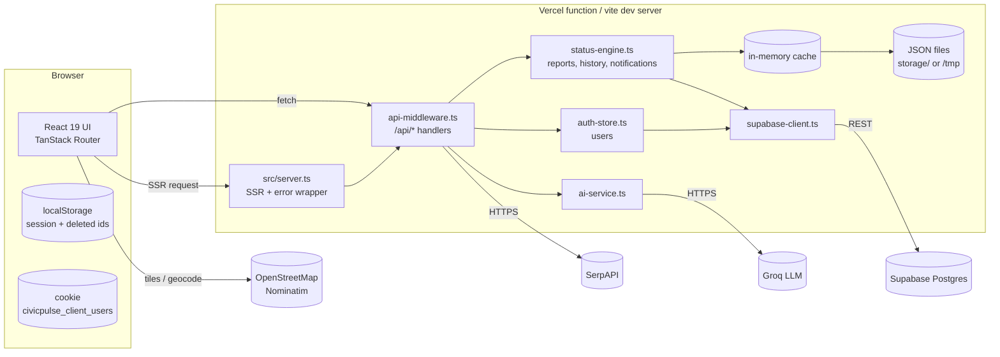

# Architecture

## 1. Overview

CivicPulse is a single full-stack TypeScript application. One codebase serves the React UI (with
server-side rendering) and a small JSON API under `/api/*`. State is kept in memory, mirrored to
JSON files, and synced to Supabase Postgres when credentials are present.

## 2. Layers

| Layer           | Location                                  | Responsibility                                                                           |
| --------------- | ----------------------------------------- | ---------------------------------------------------------------------------------------- |
| Routes / pages  | `src/routes/*.tsx`                        | File-based routes (TanStack Router). Large page components own their local state.        |
| Site components | `src/components/site/*`                   | Layout, maps, chatbot, shared primitives. `components/ui/*` is shadcn/Radix.             |
| Client libs     | `src/lib/auth-client.ts`, `civic-data.ts` | Auth session in `localStorage`; domain types, demo data, routing rules, mock classifier. |
| API gateway     | `src/lib/server/api-middleware.ts`        | Hand-rolled router for `/api/*`; used by both the production server and Vite dev.        |
| Domain engine   | `src/lib/server/status-engine.ts`         | Report CRUD, status transitions, history, notifications, upvotes, deletion.              |
| Auth store      | `src/lib/server/auth-store.ts`            | User registry, password check, seeded users, cookie sync.                                |
| AI service      | `src/lib/server/ai-service.ts`            | Groq chat-completions wrappers with deterministic fallbacks.                             |
| Persistence     | `src/lib/server/supabase-client.ts`       | REST bridge to Supabase (best-effort, never blocks the request).                         |
| Server entry    | `src/server.ts`                           | Wraps TanStack Start's server entry; turns swallowed 5xx into a friendly page.           |

## 3. Request flow

**Production (Vercel):** `src/server.ts` is the server entry. For a request it first lets
`handleApiRequest` claim `/api/*` paths; everything else goes to TanStack Start for SSR.

**Development:** `civicPulseApiPlugin()` (registered in `vite.config.ts`) installs the same API
handlers as Vite middleware, so `bun run dev` serves UI and API from one port (8080). The handlers
are duplicated in two forms — a Fetch-API version (`handleApiRequest`) and a Node `req/res` version
(`civicPulseApiPlugin`) — see [ADR-0007](adr/0007-custom-api-middleware.md) and the tech-debt list.

## 4. Persistence model (hybrid, three tiers)

Reads and writes go through `status-engine.ts` / `auth-store.ts`:

1. **In-memory cache** — authoritative within a running process.
2. **JSON files** — `storage/*.json` locally; `/tmp/civic-storage` on Vercel (ephemeral, per
   container). Loaded by `loadFromDisk()` before each operation, written by `saveToDisk()`.
3. **Supabase Postgres** — when `SUPABASE_*` env vars are set, every write is also pushed via REST
   (`saveReportToSupabase`, `saveStatusHistoryToSupabase`, `saveUserToSupabase`). Failures are
   swallowed (`.catch(() => {})`) so the user flow never blocks.

Consequences: on Vercel, files in `/tmp` do not survive cold starts or span containers, so
**Supabase is the only durable store in production** — and because sync is fire-and-forget and the
app does not read reports back from Supabase on cold start, durability is currently weaker than it
looks. Details and fix proposals: [ADR-0005](adr/0005-hybrid-persistence.md),
[known issues](known-issues-and-roadmap.md).

Users additionally get a cross-container sync trick: the server sets a cookie
(`civicpulse_client_users`) containing the user list, and `syncUsersFromCookie` merges it back on
each request. This is a workaround for the ephemeral filesystem and has serious security
implications ([security.md](security.md)).

## 5. Key flows

### 5.1 Submitting a report (`/report`)

1. Citizen picks category, writes/dictates a description (Web Speech API), attaches photo/video
   (read client-side with `FileReader` → data URLs), and captures or searches a location
   (browser GPS, Nominatim geocoding, Leaflet map).
2. `POST /api/ai/analyze` returns an AI category/priority/summary suggestion (falls back to
   `mockClassify`). The citizen can edit it.
3. **Duplicate check**: nearby existing reports are found with the Haversine distance
   (`calculateDistanceMeters`); `POST /api/ai/duplicate-check` compares text. A report is flagged as a
   likely duplicate if the AI says so, similarity ≥ 60 %, or it is within 80 m. The citizen can
   upvote/attach to the existing report instead of filing a new one
   ([ADR-0010](adr/0010-duplicate-detection-and-upvoting.md)).
4. `POST /api/status/submit` stores the report, writes the first history entry, creates a
   notification and syncs to Supabase.

### 5.2 Processing a report (`/admin/reports`)

Staff move a report through the lifecycle with `POST /api/status/transition` (assign department,
assign worker, start work, submit resolution with evidence, resolve, reject, reopen). Every
transition appends a `StatusHistoryEntry` and a notification. When a resolution is submitted with
`runAiCheck`, the AI compares notes/evidence against the original report under an ~800 ms budget so
the transition is never delayed. See [data-model.md](data-model.md).

### 5.3 Upvoting

`POST /api/reports/upvote` increments a report's `upvotes`, deduplicated per claimed username and
per client IP (`upvotedBy`), appends an audit entry and syncs `upvotes`/`upvoted_by` to Supabase.

### 5.4 PulseBot chatbot

`POST /api/ai/chat` sends the conversation plus the citizen's context to Groq, trying several models
in order. If every model fails it returns a deterministic, rule-based reply labelled "Offline
Fallback" ([ADR-0006](adr/0006-groq-ai-with-fallbacks.md)).

## 6. Cross-cutting concerns

| Concern        | Approach                                                                                                                                                                         |
| -------------- | -------------------------------------------------------------------------------------------------------------------------------------------------------------------------------- |
| Error handling | `src/lib/error-capture.ts` records server errors; `src/server.ts` renders a branded error page for swallowed 500s; client has error reporting hooks in `lib/error-reporting.ts`. |
| Styling        | Tailwind v4 with design tokens in `src/styles.css`; components never hardcode colors; motion respects `prefers-reduced-motion`.                                                  |
| i18n           | Language list exists in `civic-data.ts` (English/Kannada/Hindi) but UI strings are not translated yet.                                                                           |
| Maps           | Leaflet + OSM tiles; Nominatim for geocoding ([ADR-0009](adr/0009-leaflet-openstreetmap.md)).                                                                                    |
| AI governance  | Every AI output is a suggestion with an edit path; low temperature (0.1–0.3); strict-JSON prompts; offline fallbacks.                                                            |
| Observability  | `console.*` logging only. No metrics, tracing or alerting yet.                                                                                                                   |

## 7. Architectural constraints worth knowing

- The server holds state in module-level variables → **not safe across multiple serverless
  instances**; on Vercel each container has its own copy.
- API endpoints currently trust the caller; there is no server-side authentication or authorization
  ([ADR-0011](adr/0011-client-held-session-auth.md), [ADR-0012](adr/0012-server-side-auth-and-rbac.md)).
- `src/routeTree.gen.ts` is generated — never edit by hand.
