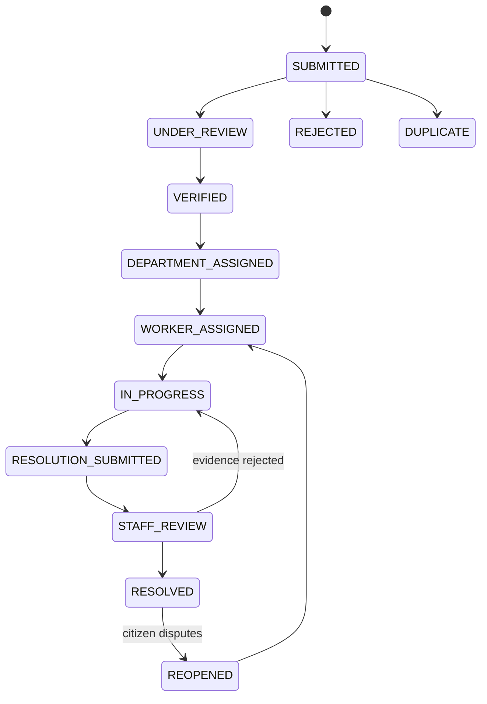

# Data Model & Report Lifecycle

## 1. Entities

| Entity         | TypeScript type                           | Supabase table                 | Notes                                           |
| -------------- | ----------------------------------------- | ------------------------------ | ----------------------------------------------- |
| Report         | `CivicReport` (`civic-data.ts`)           | `public.reports`               | Source of truth for a complaint                 |
| Status history | `StatusHistoryEntry` (`status-engine.ts`) | `public.report_status_history` | Append-only audit trail; also records upvotes   |
| Notification   | `NotificationItem`                        | `public.notifications`         | channel: `in_app` \| `email` \| `sms`           |
| Department     | `DEPARTMENTS` constant                    | `public.departments`           | Static in code today                            |
| Field worker   | `FIELD_WORKERS` constant                  | `public.field_workers`         | Static in code today                            |
| User           | `AppUser` / `SafeUser`                    | `public.app_users`             | Roles: `admin`, `citizen` (`staff` in schema)   |
| Category       | `CATEGORIES`                              | —                              | roads, electricity, waste, water, safety, parks |
| Routing rule   | `ROUTING_RULES`                           | —                              | issue → department mapping                      |

### `CivicReport` (key fields)

`id`, `title`, `category`/`categoryLabel`, `description`, `ward`, `area`, `address`,
`latitude`/`longitude`, `x`/`y` (percent position on the illustrated demo map), `status`,
`priority` (`low|medium|high|critical`), `department`, `worker`, `createdAt`/`updatedAt`,
`aiConfidence`, `duplicateProbability`, `upvotes`, `upvotedBy?`, `anonymous`, `mediaUrls`,
`workerMediaUrls`, `resolutionMediaUrls`, `resolutionNotes?`.

Media are stored inline as data URLs or as paths under `public/media/evidence`; there is no object
storage yet.

## 2. Lifecycle

The product timeline (`TIMELINE_STEPS`) is: Submitted → Verified → Department assigned → Field worker
assigned → In progress → Resolved → Citizen notified.

This is the **schema's** 12-value `report_status` enum arranged as a _proposed_ flow. The linear
order follows the enum and the product timeline; the side branches (`REJECTED`, `DUPLICATE`,
`REOPENED`, "evidence rejected") are illustrative — the code does not define them. Be aware of
two inconsistencies (tracked in [known issues](known-issues-and-roadmap.md)):

1. The front-end `ReportStatus` type in `civic-data.ts` has only six lowercase values:
   `submitted, verified, assigned, in_progress, resolved, duplicate`.
2. `transitionReportStatus` does **not** validate allowed transitions; any caller can set any
   status. The diagram above is the intent, not an enforced state machine.

Each transition:

1. updates the report and `updatedAt`;
2. appends a history entry (`oldStatus`, `newStatus`, `changedBy`, `role`, `comment`, `metadata`);
3. creates a notification for the citizen;
4. fire-and-forget syncs to Supabase;
5. optionally runs AI resolution verification (≤ ~800 ms) when a resolution is submitted.

If a transition references an unknown report id, the engine **synthesizes** a placeholder report
(streetlight/pothole demo data). This exists to keep the demo flows working but can create phantom
reports — see known issues.

## 3. Supabase schema (`supabase/schema.sql`)

| Table / object          | Purpose                                                                                             |
| ----------------------- | --------------------------------------------------------------------------------------------------- |
| `report_status` enum    | 12 workflow states                                                                                  |
| `report_priority` enum  | low / medium / high / critical                                                                      |
| `departments`           | name, contact, open/resolved counters, avg days                                                     |
| `field_workers`         | name, department FK, capacity, open tasks, status                                                   |
| `reports`               | full report incl. `tracking_id` (auto-generated), `upvotes`, `upvoted_by TEXT[]`, GPS, media arrays |
| `report_status_history` | audit trail; index `idx_status_history_report (report_id, changed_at)`                              |
| `notifications`         | per-user notifications                                                                              |
| `app_users`             | `username` (unique), `password_hash`, `role`, `display_name`                                        |

Realtime publication is enabled for history, notifications and `app_users`. **RLS is enabled with
permissive policies** — notably `app_users` is publicly readable, insertable and updatable
([security.md](security.md)). The schema file is idempotent where possible (`IF NOT EXISTS`); the
`upvoted_by` column ships both in the `CREATE TABLE` and as an `ALTER TABLE … ADD COLUMN IF NOT
EXISTS` migration for existing databases.

### Applying the schema

Run `supabase/schema.sql` in the Supabase SQL editor (or `psql`). It is safe to re-run, with the
caveat that `CREATE POLICY` statements are not idempotent and will error if the policy exists —
drop the policy first or run only the new statements when migrating.

## 4. Local storage files

| File                               | Content                     | Committed?              |
| ---------------------------------- | --------------------------- | ----------------------- |
| `storage/civic-reports.json`       | reports                     | yes (demo seed)         |
| `storage/civic-history.json`       | history entries             | yes                     |
| `storage/civic-notifications.json` | notifications               | yes                     |
| `storage/civic-users.json`         | users incl. password hashes | yes — see security      |
| `storage/civic-deleted.json`       | deleted-report tombstones   | no (created at runtime) |

On Vercel the same files live in `/tmp/civic-storage` (ephemeral).
